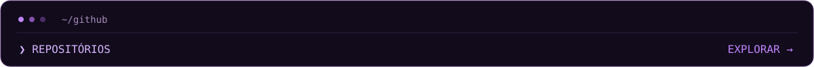

  

  

  <a href="https://github.com/kauebrederg?tab=repositories">Repositórios</a> &nbsp; · &nbsp;
  <a href="https://github.com/kauebrederg?tab=stars">Stars</a> &nbsp; · &nbsp;
  <a href="https://github.com/kauebrederg#overview">Atividade</a>

